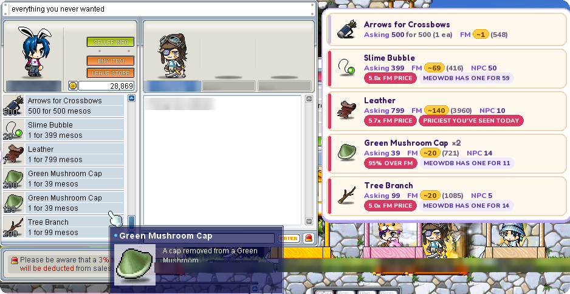
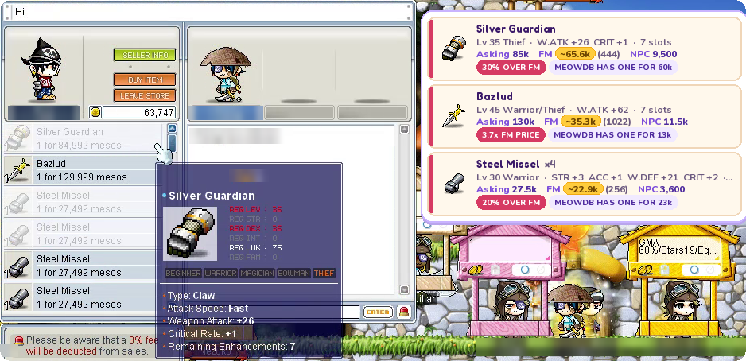
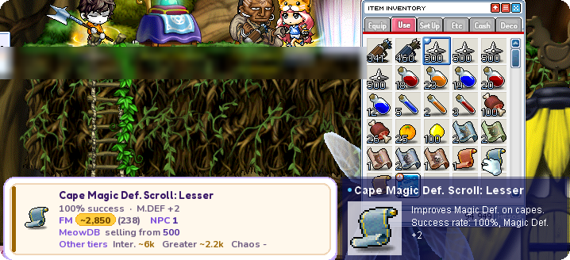
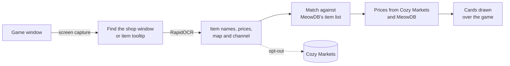

> [!IMPORTANT]
> **Disclaimer: packet reader in 2.5.9.** The released MaplePrice 2.5.9 includes a packet reader that reads the
> game's network traffic to decode equipment stats. That packet reader is **not** in this repository: the code here
> only reads the screen (OCR). The packet reader will be removed from the app after 2.5.9, now that the stats
> players share have become reliable.

<div align="center">


# MaplePrice

**A little help for your next great find.**

A price overlay for MapleStory Classic's Free Market, from [Cozy Markets](https://cozy.markets).


-F28C28)


</div>

---

Open a player's shop and MaplePrice puts a price card next to every listing. Each card shows what the item usually
sells for, what NPCs pay for it, and whether the asking price is a deal. It reads everything off your screen, so it
never touches the game itself.

<p align="center">
  
</p>

## Features

<table>
<tr>
<td width="50%" valign="top">

### 🛒 Shop prices
Every listing is priced as soon as the shop opens or scrolls. Tags like **DEAL 29% UNDER FM** and **3.6x FM PRICE**
make good and bad prices stand out, and other tiers of the same scroll are listed beside it.

</td>
<td width="50%" valign="top">

### 🔎 Hover prices
Press **F7**, then rest your cursor on any item: in your inventory, an NPC shop or anywhere else a tooltip shows. Its
price card pops up beside the tooltip.

</td>
</tr>
<tr>
<td valign="top">

### ⚔️ Equipment
Equips show their level, job and stats, and are compared with what the same item goes for across the market.

</td>
<td valign="top">

### 🔔 Price alerts
Sign in with Discord and press **F6** over an item to watch it. You get a pop-up (and a chime) when it's listed
under your price.

</td>
</tr>
<tr>
<td valign="top">

### 🗺️ Knows where you are
Reads the Free Market room off the minimap and your channel from the game's connection or the Change Channel
window, so every shop it shares can be found again.

</td>
<td valign="top">

### 🤝 Shared with Cozy Markets
Shops you pass are shared with [cozy.markets](https://cozy.markets) (opt-out in F10), so everyone gets fresher
prices. Your character name stays on your PC.

</td>
</tr>
</table>

<p align="center">
  
  
</p>

## Hotkeys

| Key | What it does |
| :-: | --- |
| <kbd>F8</kbd> | Scan the open shop now (shops also scan by themselves as they open) |
| <kbd>F9</kbd> | Clear what's drawn |
| <kbd>F10</kbd> | Options: switches, sign-in, language (English / 中文), overlay size |
| <kbd>F7</kbd> | Hover prices on or off |
| <kbd>F6</kbd> | Add the hovered item to your price alerts |

Every key can be rebound in F10.

## How it works



## Getting started

You need Windows 10 or 11 and [Python 3.12](https://www.python.org/downloads/).

```bat
py -3.12 -m pip install -r requirements.txt
py -3.12 run.py
```

Run it as administrator: Windows only lets it see its hotkeys while the game has focus when it's elevated.
Settings, the log and the local price history live in `%LOCALAPPDATA%\mapleprice` (`log.txt` is the first place to
look when something's off).

To try it on a saved screenshot instead of the live game:

```bat
py -3.12 run.py --image shot.png --out annotated.png
```

## Development

```bat
py -3.12 -m pytest tests -q
```

The tests run on screenshots in `tests/fixtures`, across window sizes, UI scales and resolutions.

To build the single-file `dist\MaplePrice.exe`, run `build.bat` (PyInstaller). Refresh the bundled icon pack after a
game patch with `py -3.12 -m mprice_decoder.iconpack`.

<details>
<summary><b>Project layout</b></summary>

| Path | What's in it |
| --- | --- |
| `run.py` | Launcher (works from any working directory) |
| `mprice_decoder/__main__.py` | The overlay: hotkeys, shop and hover watching, scans |
| `mprice_decoder/ocr.py`, `shop.py` | Finding the shop window and tooltips, reading names and prices |
| `mprice_decoder/data.py` | Local item database, MeowDB lookups, scan log |
| `mprice_decoder/cozy_prices.py`, `sync.py`, `feed.py` | Cozy Markets prices, scan sharing, the price feed |
| `mprice_decoder/annotate.py`, `render.py`, `overlay.py` | Building and drawing the cards |
| `mprice_decoder/alerts.py`, `auth.py` | Discord sign-in and price alerts |
| `mprice_decoder/ui_host.py`, `ui_child.py`, `assets/ui` | The F10 and alert windows (React, via pywebview) |
| `mprice_decoder/update.py` | Signed self-updates |
| `tools/` | Splash screen, alert chime and startup helpers |
| `tests/` | pytest suite and screenshot fixtures |

</details>

---

<div align="center">
<sub>Made for the MapleStory Classic community by <a href="https://cozy.markets">Cozy Markets</a>. Not affiliated with Nexon.</sub>
</div>
